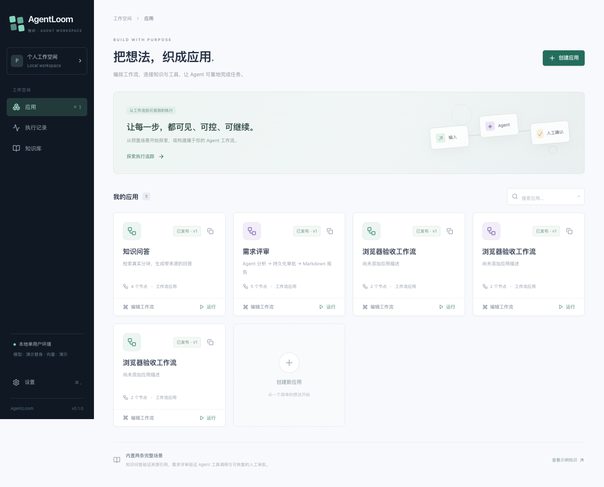

# AgentLoom · 智织

面向开发者的 Agent 应用开发与运行平台。通过可视化工作流，把知识检索、受限工具和人工审批织成可观测、可恢复的任务。

**首版面向本地单用户。** 默认无需模型密钥的演示模式，任务仍然实际经过 API、PostgreSQL 队列、独立 worker、LangGraph 检查点、pgvector 与持久化事件。没有前端播放脚本，也没有模拟业务指标。



## 已实现

- React Flow 画布：7 种节点、拖拽、连线、属性、删除、撤销重做、自动保存、校验与发布。
- 不可变工作流版本、运行配置快照、乐观草稿锁、幂等创建任务。
- 独立 Python worker，PostgreSQL `FOR UPDATE SKIP LOCKED` 领取、心跳租约、整次图调用的 advisory lock、崩溃恢复。
- LangGraph `PostgresSaver` 检查点与 `interrupt` / `Command(resume=...)` 人工审批。暂停释放 worker，支持修改后继续、拒绝、重复提交保护。
- SSE 历史补拉、游标、心跳、断线重连、去重、文本批处理。刷新可恢复输入输出、节点耗时、工具与来源。
- TXT / UTF-8 Markdown / 文本 PDF 上传、持久化源文件、异步分块与索引、原文查看、检索测试。
- 分别配置模型与 Embedding，真实模式使用 OpenAI 兼容 Chat Completions 与 Embeddings；后端持有凭据。
- 知识问答与需求评审预置场景；报告可下载 Markdown。
- 隔离数据库可靠性测试、真实浏览器验收、画布测量与小型 Recall@k 评测。

## 快速启动

需要 Node.js 24、pnpm 11.5.1、[uv](https://docs.astral.sh/uv/)、Docker Compose。uv 会使用 Python 3.11。锁文件为 `pnpm-lock.yaml` 和 `services/api/uv.lock`。

```bash
cp .env.example .env
# 首次可通过 corepack 或 npm install -g pnpm@11.5.1 准备 pnpm
./scripts/dev.sh
```

打开 [本地工作台](http://127.0.0.1:5173)，[API 文档](http://127.0.0.1:8000/docs)。数据库端口为 `127.0.0.1:5438`。脚本先安装锁定依赖，再启动数据库、迁移、示例数据、API、worker 与前端。Ctrl+C 结束应用进程，数据库卷保留。

也可以分开启动，便于断点调试与重启 worker：

```bash
pnpm install --frozen-lockfile
cd services/api
uv sync --frozen --python 3.11
cd ../..
docker compose up -d db --wait
cd services/api
uv run --frozen alembic upgrade head
uv run --frozen python -m agentloom.seed
uv run --frozen uvicorn agentloom.main:app --host 127.0.0.1 --port 8000
# 另一个终端，services/api 目录
uv run --frozen python -m agentloom.worker
# 第三个终端，仓库根目录
pnpm dev
```

端口冲突时先结束旧进程。示例数据脚本可以重复运行，不覆盖已编辑的应用。首次打开知识库，等待 worker 将三份示例资料的状态更新为“已索引”。

### 全容器方式

```bash
cp .env.example .env
docker compose up --build -d
# http://127.0.0.1:5173
docker compose logs -f api worker
docker compose down  # 保留数据卷
```

迁移容器成功后 API 和 worker 才启动。前端 Nginx 代理 `/api` 并关闭 SSE 缓冲。数据库使用 `pgvector/pgvector:0.8.2-pg17`。所有映射端口仅绑定 127.0.0.1。

完整镜像构建需要能够访问 Docker Hub 与 ghcr.io；当前交付环境中的全容器构建遇到 Docker Hub 授权端点网络超时，尚未完成完整镜像启动验收。本机开发启动路径和真实 PostgreSQL 容器已验证。详见 [验证记录](docs/verification.md)。

## 演示场景

### 知识问答

1. 进入“知识库”，确认示例文件已索引，可先检索“人工审批如何在重启后恢复”。
2. 在“知识问答”中编辑画布；点击节点可以调整提示词与变量。修改会在停止拖动或编辑后延迟约 900ms 保存。
3. 校验并发布，选择发布版本调试，输入 question。
4. 查看运行输出、节点输入输出、SSE 时间线与真实命中来源；下载 Markdown。

### 需求评审与重启

1. 运行“需求评审”，输入 requirement，例如“构建一个支持恢复的人工审批系统”。
2. worker 执行检索与 Agent 工具调用，在人工审批节点暂停。演示 Agent 按配置选择第一个白名单工具，明确是确定性演示行为。
3. 停止并重新启动 worker，也可以同时重启 API。数据库卷不能删除。
4. 从执行记录打开原任务，修改报告并“确认并继续”。原 runId、版本与检查点保持一致。
5. 拒绝会使任务失败并记录明确原因；重复审批返回 409。取消正在执行的任务会先显示“取消请求中”，由 worker 确认停止后转为“已取消”。

浏览器关闭不影响任务。刷新运行详情时先查询持久化记录，再从事件游标恢复展示。任务为“等待执行”且长期没有进展时，应检查独立 worker 是否启动。

## 真实模型与 Embedding

二者独立设置。默认演示模型输出可预测的来源摘录或报告；演示向量是 256 维字符/bigram 哈希特征，**不代表真实语义能力**。演示用量显示“未知”，不会伪造费用或 Token。

编辑根目录 `.env`：

```dotenv
MODEL_MODE=openai
MODEL_BASE_URL=https://api.openai.com/v1
MODEL_NAME=gpt-4.1-mini
MODEL_API_KEY=在本机填写
EMBEDDING_MODE=openai
EMBEDDING_BASE_URL=https://api.openai.com/v1
EMBEDDING_MODEL=text-embedding-3-small
EMBEDDING_API_KEY=在本机填写
EMBEDDING_DIMENSIONS=1536
```

重启 API 与 worker。若曾通过设置页保存过配置，数据库配置优先于 `.env` 的非敏感字段，因此也需在设置页选择真实接口、保存并测试。密钥始终来自后端环境，浏览器只能看到“是否已配置”。不要向 Git 提交 `.env`。

1. 分别测试已保存的模型连接与 Embedding 连接。
2. 对知识文件点击“重新索引”，等待新模型索引 ready。检索严格匹配 Embedding 模型、地址、维度与索引版本，不混用不同向量空间。
3. 运行已发布的知识问答版本。

模型接口要求支持 Chat Completions SSE、`stream_options.include_usage`、`max_completion_tokens`；Agent 还需支持 function tool calling。Embedding 要求支持 `/embeddings` 的 `dimensions` 参数。首版只保证这一接口形态，不声称支持所有“兼容”供应商。SDK 协议已用注入 HTTP 替身验证；当前没有真实付费密钥，**真实供应商连接与回答质量尚未实测**。不支持的参数或模型会清楚失败，不偷偷降级到演示模式。

LLM 节点转发真实流式文本；Agent 工具循环逐次请求完成后，分批发布最终文本。只展示公开输出与工具信息，不索取内部思维链。

## 工作流语义

| 节点 | 主要参数 | 输出 |
|---|---|---|
| Start | `fields` 非空英文标识符数组 | 声明的输入字段 |
| LLM | `prompt` 模板 | `text`, `citations` |
| Knowledge Retrieval | `kbId`, `query`, `topK` | `text`, `hits` |
| Agent | `prompt`, 白名单 `tools`, `maxSteps`, `maxTools`, `kbId` | `text`, `citations` |
| Condition | `ref`, 可选 JSON 字段 `path`, `operator`, JSON `value` | 布尔 `value` |
| Human Approval | `text` 模板 | `approved`, 修改后的 `text` |
| End | `template` | `text`, 验证过的 `citations` |

变量使用 `{{input.question}}`、`{{retrieve.text}}` 等形式。仅允许引用祖先节点的已声明输出。条件分支必须有 true / false 各一个端口，支持严格类型相等、文本包含与真值判断。编辑器比较值使用 JSON，如 `"通过"`、`true`。对于模型返回的 JSON 文本，可以把 ref 设为 `{{classify.text}}`、path 设为 `review.required`，提取结构化布尔字段；非法 JSON 或缺失字段会明确失败。

可视图是 DAG，平台按拓扑顺序串行调度；分支只激活选中的路径，汇合点采用 **OR 激活、等待所有拓扑前驱判定完毕** 的语义。引用未选中分支的输出会报明确错误，首版不提供自动可选变量合并。运行时编译成含调度 router 与实际业务节点的 LangGraph；图内部 router 回边不代表允许用户创建有环工作流。

工具仅有受 AST 白名单约束的计算器与指定知识库查询，均为只读。没有任意 Shell、Python、文件访问或自动多 Agent 团队。

## 测试与评测

```bash
# 数据库容器已启动；测试脚本使用独立 agentloom_test 数据库
./scripts/test.sh
# API、worker、Vite 已启动时
pnpm --filter @agentloom/web test:ui
# 本机需要 Chrome；Linux CI 可调整 Playwright channel 并安装 Chromium
pnpm perf
# 小型检索评测
cd services/api
uv run --frozen python ../../scripts/evaluate.py --k 1 3
```

后端 21 项测试包含多进程重启审批恢复、崩溃窗口、并发幂等、互斥领取、advisory fencing、取消状态、分支、文件关联与 SDK 协议；前端 10 项测试包含引用稳定性、撤销、拖拽持久化边界、事件补拉去重与重试文本。浏览器测试覆盖真实页面操作。见 [验证记录](docs/verification.md)。

- [画布测量方法与原始数据](docs/performance.md)：100/300/500 节点、各 3 次；没有优化前基线，不报告提升百分比。
- [检索评测说明](eval/README.md)：8 个问题、3 个标注分块，提供逐题结果；该规模只适合烟雾验证。
- [架构与状态机](docs/architecture.md)
- [面试材料：难点、取舍与验证](docs/interview.md)

## 边界与限制

本地单用户、无登录与租户隔离，不能直接公网部署。未实现计费、插件市场、任意代码执行、OCR、Kubernetes 和自动多 Agent 团队。首版 DAG 节点按顺序运行，未实现图级并行。

外部副作用不具备 exactly-once 保证；检查点、幂等键与工具日志不能替代外部系统的幂等协议。未来引入写工具需要增加对账与未知结果处理。合作式取消可能等待正在进行的网络调用返回；失联 worker 的取消无法确认时标为“需人工检查”，不会显示已取消。

当前运行时间限制统计已完成节点耗时和当前执行片段，审批等待不计入；进程突然退出前尚未记录的时间不能精确还原。模型单请求最多 25 秒超时，完成后再次检查时间与取消状态。总恢复次数超过 3 次标记需人工检查。索引任务没有自动有限重试，失败可手动重建。

引用校验保证引用来自本次检索快照，并移除无效引用标记；不保证每个句子被引用充分支持，仍需人审和更大评测。默认 256/1536 维向量提供 HNSW 表达式索引，其他维度使用精确向量距离扫描；小规模数据下 PostgreSQL 也可能选择顺序扫描。

源文件和执行内容存储于本地 PostgreSQL，保留策略与加密备份暂未实现。大文件上限 10 MiB / 1000 块，图上限 500 节点 / 2000 连线，运行列表展示最近 100 条。

## 目录

```text
apps/web/                 React / React Flow / Zustand / Tailwind UI
packages/protocol/        共享类型、前端图校验、事件合并协议
services/api/agentloom/   FastAPI、数据库、执行器、worker、知识链路
services/api/migrations/  Alembic 固定初始 DDL 与向量索引迁移
services/api/tests/       真实 PostgreSQL 集成测试
scripts/                 启动、测试、检索评测
compose.yaml             本地数据库 + 迁移 + API + worker + web
```

MIT License，参见 [LICENSE](LICENSE)。欢迎参考 [CONTRIBUTING.md](CONTRIBUTING.md) 参与。
