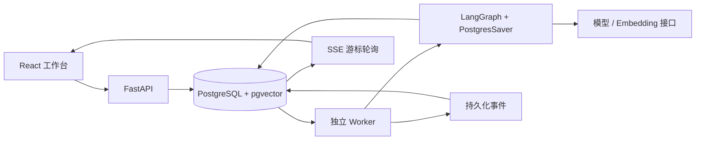
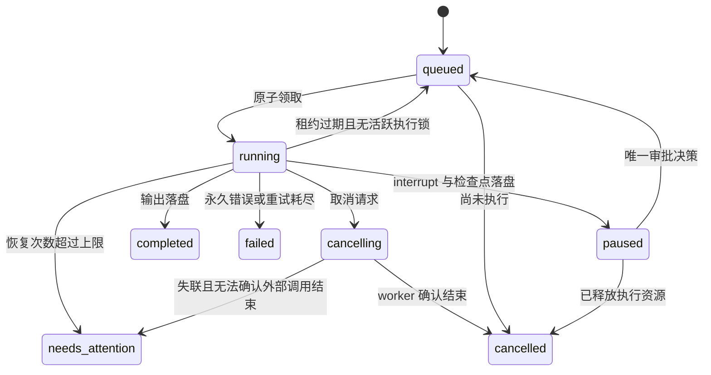

# AgentLoom 架构

## 组件与数据流



前端使用 pnpm workspace 共享协议。API 负责草稿、发布、运行创建、审批决策、文件上传与只读追踪。API 不通过内存后台任务执行长流程。worker 从 PostgreSQL 持久化表领取工作，数据库本身保存输入、版本关联、配置快照和事件。

## 平台与框架边界

| 平台实现 | LangGraph 提供 |
|---|---|
| DAG 与参数校验、变量祖先校验、草稿乐观锁 | StateGraph 节点与状态执行 |
| 发布版本、数据库不可变触发器、配置快照 | 按 thread_id 管理图检查点 |
| 分支激活、拓扑串行 router、OR 汇合语义 | PostgresSaver 保存状态、任务和挂起信息 |
| 任务领取、心跳、租约、互斥 fencing、恢复审计 | interrupt 暂停与 Command 恢复值 |
| 节点结果缓存、工具日志、幂等键、审批去重 | 从已保存的图进度继续调用 |
| 事件持久化、SSE、UI 去重、引用关联、评测 | 不提供本平台的队列、业务权限或外部 exactly-once |

编译器为每个可视节点创建真实 LangGraph 节点，并加入一个 router。router 根据不可变图的拓扑顺序与检查点中的 outputs 选择下一节点。可视 Condition 的 sourceHandle true / false 决定活跃分支。Condition 还支持对 JSON 文本或对象按点分字段路径取值并作严格类型判断，非法 JSON 或缺失字段会失败。多个前驱的汇合采用 OR 激活，但只在所有拓扑前驱被执行或判定跳过后运行。节点引用未执行分支时直接失败，避免静默混入空值。

LangGraph 的 thread_id 等于平台 runId。工作流版本和运行配置在创建任务时绑定；API 没有修改版本的接口，数据库也阻止 UPDATE / DELETE 已发布版本。节点内部的 Agent 循环有步骤、工具调用和活跃时间预算。

## 数据模型

- apps：可变 draft、revision 乐观锁。
- versions：发布时复制整个 graph，不可变。
- runs：version_id、输入、非敏感配置快照、幂等键和请求哈希、执行状态、租约、所有者、事件序号、恢复次数。
- node_records：run/node 唯一，保存节点输入输出、耗时、重试与实际返回 usage。
- approvals：run/node 唯一，pending / resolved、原稿与审批决策。
- tool_calls：稳定调用 ID、工具名、参数 SHA256 摘要、参数、结果、重试数与状态。
- events：每个 run 内递增 event_id，事件类型、时间、节点、载荷，部分关键边界带去重键。
- knowledge_bases / documents / chunks：源文件字节、索引任务状态、原文、页码、分块序号、模型空间签名和 pgvector 向量。
- platform_settings：非敏感配置；API key 只在进程环境里，不复制到数据库快照。
- checkpoint_*：LangGraph 官方 PostgresSaver 管理，自带迁移 setup；业务迁移由 Alembic 管理。

初始迁移保存固定 DDL，后续迁移增加 256/1536 维 HNSW 表达式索引和版本不可变触发器。源文件存在数据库，容器重建不依赖临时文件系统；删除 Docker 数据卷会丢失这些本地数据。

## 运行状态机



queued/running/paused/cancelling/failed/cancelled 是不同状态。拒绝审批进入 failed 并附上拒绝原因。needs_attention 不会被 worker 自动再次领取，应检查原因后创建新的执行。

### 领取与 fencing

领取事务使用 `SELECT ... FOR UPDATE SKIP LOCKED`，提交 owner 与 30 秒租约。worker 每 3 秒心跳，在独立线程中刷新租约；单 worker 一次只运行一个业务任务或索引任务。

整次 LangGraph invoke 持有以 runId 哈希的 PostgreSQL session advisory lock，包括框架自己的检查点写入。恢复事务必须先取得同键的 transaction advisory lock，避免心跳暂时落后时出现两个图执行器。正常进程崩溃会关闭连接并释放锁；仍持有锁的活跃进程不能仅因租约到期被接管。节点完成前还会在事务里核对 owner。这些机制使未来多 worker 领取安全，但当前交付没有宣称完成大规模多 worker 压测。

数据库网络分区下，无法绝对证明已发出的外部请求已经结束。工具当前全部只读；取消失联的 worker 标记 needs_attention。持续持有 advisory lock 的卡死进程需要人工终止，不能用强行夺锁掩盖并发风险。

### 崩溃窗口与恢复

| 崩溃位置 | 恢复行为 |
|---|---|
| 创建运行事务未提交 | 幂等重试创建，未提交记录不可见 |
| 领取后、节点开始前 | 租约过期，重新领取 |
| 节点执行中、结果未提交 | 从最近检查点重跑；只读工具允许重试 |
| 节点结果与完成事件已提交、框架检查点未提交 | 命中 node_records 缓存，避免重发已完成节点与重复工具 |
| approval 记录已写、interrupt 检查点未写 | 重新进入节点复用 approval，继续持久化 interrupt |
| interrupt 检查点已写、run paused 未写 | 租约恢复后读取检查点，再标记 paused |
| 审批决策和 queued 已提交、恢复调用未执行 | 新 worker 读取决策，使用同一 thread_id 恢复 |
| End 结果已写、run completed 未写 | 复用缓存与检查点，再提交终态 |

这不是跨系统 exactly-once。模型调用可能因崩溃重复计费，未提交的流式文本也可能出现多个尝试。前端保留事件，按 attempt 显示当前尝试文本；run 输出只在最终成功后出现。

### 审批一致性

审批写入与 approval.required 同事务。interrupt 自己保存 LangGraph 检查点，随后 worker 才将 run 更新为 paused、释放所有权与锁。若用户过早提交，API 返回“尚未持久化暂停”，避免批准一个不能恢复的状态。

审批事务先锁 run 再锁 approval，校验 pending 和 paused，原子写决策、queued 与 approval.resolved。重复审批返回 409。恢复时匹配检查点里挂起的 approvalId，不能把旧节点的决策误用到另一个审批节点。

## 事件与 SSE

事件形状：

```json
{"runId":"...","eventId":12,"nodeId":"answer","time":"2026-10-26T10:00:00+00:00","type":"message.delta","data":{"text":"内容","attempt":0}}
```

核心类型包括 run.started、node.started/completed/failed、message.delta、tool.started/completed/failed、approval.required/resolved、run.completed/failed/cancelled。另有重试、恢复、取消请求与无效引用审计事件。

emit 对 run 行加锁分配递增序号，提交后 SSE 查询才可见。SSE 无内存广播依赖，每 400ms 查询一次最多 200 条，10 秒注释心跳，提示客户端 1500ms 重试。`after` 与 `Last-Event-ID` 取较大的有效游标；终态补拉完后发送 settled 并关闭。普通历史接口每次最多 1000 条，可继续通过最后一个 ID 补拉。

客户端在 70ms 窗口内合并增量，用 eventId 去重。画布节点只订阅自己的执行状态；文本与时间线在调试面板订阅。页面刷新重新获取运行快照，并从事件表重建增量。数据库压力随 SSE 连接数增长，首版单用户可接受；更大规模可以增加通知层，但事件表仍应是重放依据。

## 错误、重试、工具与限制

模型与检索瞬时网络错误、429、服务端错误最多执行 3 次，退避为 0.3/0.6 秒；永久参数与权限错误不自动重试。SDK 自带重试关闭，避免两层重试相乘。模型响应中的实际 usage 才入库，缺失就是 null。Agent 合计各已返回响应的实际用量，即使后续请求失败也保留；未报告 usage 或失败请求的用量标为未知。模型请求步骤与工具预算在数据库中累计，重试与崩溃恢复不会重置预算，不估算费用。

工具计算器仅接受有界 AST 的常数、四则和取模，禁止函数、属性、幂运算、任意代码。知识工具只能查询节点指定的知识库。只读工具的已分类瞬时错误最多 3 次，参数错误立即失败。调用 ID 来自 run/node/序号/工具/参数摘要，成功日志可在重放时复用。未来写工具必须区分幂等、不可重试、结果不明，并引入外部幂等键或对账，不能直接沿用只读重试策略。

取消采用协作检查，检查节点、工具与流式 chunk 边界；阻塞的网络请求返回前保持 cancelling。活跃时限由完成节点耗时加当前执行片段组成，审批等待不计入。崩溃前未记录的耗时无法精确累加，这是首版已知边界。

## 知识与引用

上传仅接受限定扩展名，源文件不作为磁盘路径使用。worker 提取 UTF-8 文本或 PDF 页文本，以 600 字符窗口、80 重叠分块，保存文件关联、页码、块序号、稳定 chunkId。无可提取文本的扫描 PDF 明确失败，不假装 OCR 成功。

每批最多 32 段生成 Embedding。同一文件的新向量与 ready 状态在一个事务里替换。索引模型空间签名包含模式、Base URL、模型与维度；检索只在当前签名内计算余弦距离。256/1536 维提供 HNSW 表达式索引，其他维度支持 pgvector 精确扫描。小语料可能不使用 HNSW，这是查询规划器的正常选择。

检索命中完整存入节点结果与图状态。最终输出中的 `[chunkId]` 只允许本次命中的 ID，无效标记会被替换并记录 citation.rejected。来源面板展示该次检索的原文快照与可下载的文件，之后重新索引也不会修改历史运行快照。来源关联不等价于断言被原文正确蕴含。

## 官方参考与锁定版本

实现前查阅并与安装的 SDK 协议测试核对：

- [LangGraph persistence](https://docs.langchain.com/oss/python/langgraph/persistence)、[interrupts](https://docs.langchain.com/oss/python/langgraph/interrupts)：检查点、thread_id 与中断恢复接口。
- [React Flow performance](https://reactflow.dev/learn/advanced-use/performance)：稳定组件引用与避免全量状态订阅。
- [SQLAlchemy PostgreSQL](https://docs.sqlalchemy.org/en/20/dialects/postgresql.html)、[pgvector-python](https://github.com/pgvector/pgvector-python)：数据库锁、向量列与距离查询。
- [Chat Completions](https://developers.openai.com/api/reference/resources/chat/subresources/completions/methods/create)、[Embeddings](https://developers.openai.com/api/reference/resources/embeddings/methods/create)：流式、工具、用量与向量协议。

本次锁定 LangGraph 1.2.17、checkpoint-postgres 3.2.0、SQLAlchemy 2.0.55、FastAPI 0.162.0、OpenAI SDK 2.54.0；React 19.3.1、React Flow 12.12.0、Zustand 5.0.8、Vite 6.4.5。完整依赖以两个锁文件为准，安装和容器构建使用 frozen 模式。
